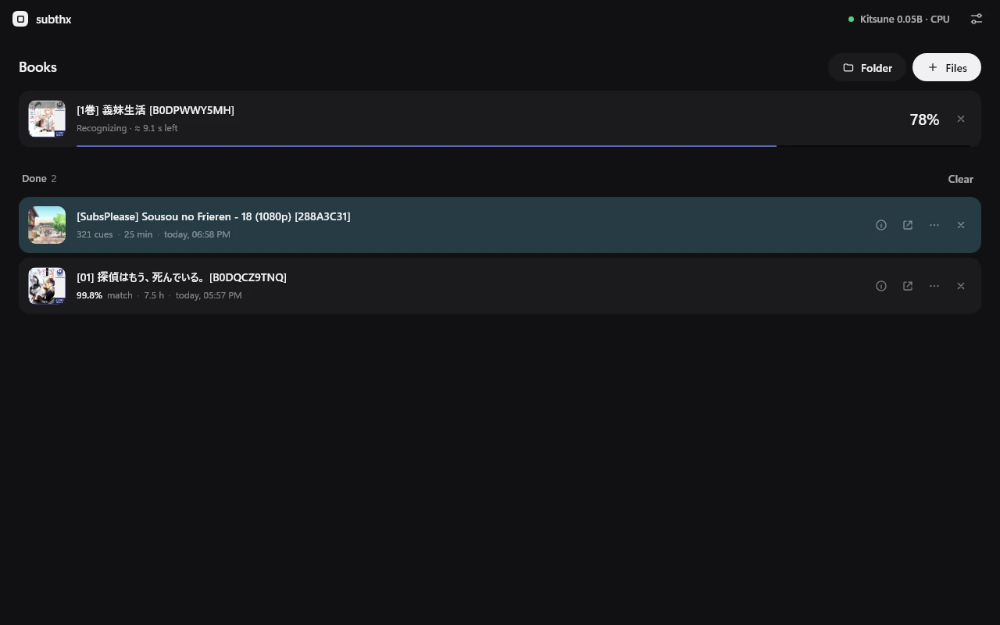
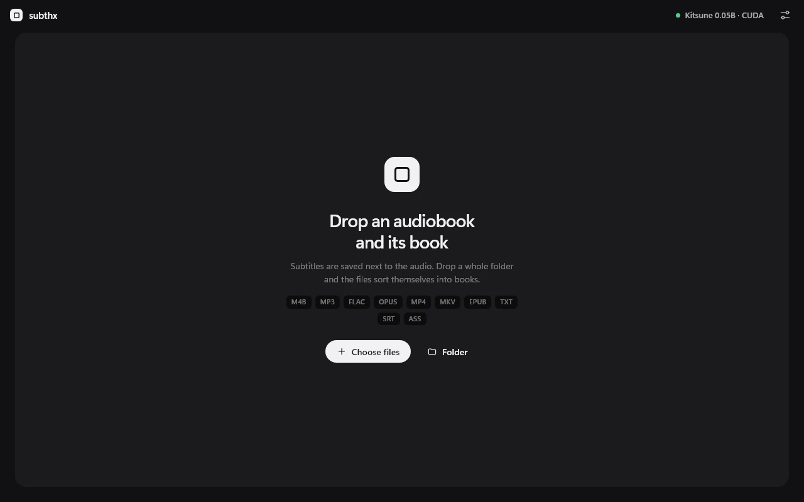

<p align="center">
  
</p>

<h1 align="center">SubThx</h1>

<p align="center"><b>Syncs audiobooks to their book text, and transcribes anime and video into subtitles.</b><br>A Rust port of SubPlz's alignment. No Python or PyTorch: the models run on ONNX Runtime.</p>

<p align="center"></p>

## What it does

- **sync**: audio + a text source → subtitles timed to the audio. The text source is either the book (epub, txt) or existing subtitles (srt, vtt, ass), which are retimed to the audio. The text is aligned to what is actually spoken, so the cues match the narration.
- **gen**: audio or video → subtitles without any text source, recognized from scratch.

Works with m4b, mp3, flac, ogg, opus, wav, mp4, mkv, webm and more. Some formats may need `ffmpeg` in `PATH`.

## Ways to use it

- **Desktop app** (Windows): drop files or a folder, the files sort themselves into books, and the queue shows progress. Models are downloaded from the model menu.
- **CLI** (`subthx`): `subthx sync` and `subthx gen` for scripts and batch work.
- **HTTP server** (`subthx serve`): keeps the models loaded and serves jobs to other programs; the reference is at `/docs`.

<p align="center"></p>

## Install and run

Download the latest zip from the [releases page](https://github.com/Kellenok/SubThx/releases). Each release is one zip, `subthx-<version>-windows-x64.zip`, with:

- `subthx-gui.exe`: the desktop app.
- `subthx.exe`: the command line and the HTTP server.
- the ONNX Runtime DLLs, which both executables need; keep them next to the executables.
- `SHA256SUMS.txt` to check the files against.

**Desktop app.** Run `subthx-gui.exe`, open the model menu and click the download icon next to a model. Kitsune 0.05B is the lightest and works on the CPU. On an NVIDIA card, choosing CUDA offers to download the CUDA libraries (about 0.9 GB) once; nothing else is needed.

**Command line.** `subthx.exe` downloads the model it needs on first use, with the VAD, into a `models` folder next to it. For European languages pass `--asr parakeet-ultra` or `--asr parakeet-redux`.

Sync an audiobook with its book (the book can be epub, txt, srt, vtt or ass):

```bash
subthx.exe sync "book.m4b" "book.epub" --output-dir out --device cpu
```

Generate subtitles for a video, without a book:

```bash
subthx.exe gen "episode.mkv" --device cuda
```

`--device` is `cuda` by default; without an NVIDIA card use `--device cpu`. `subthx.exe sync --help` lists all options, `-d <folder>` processes a folder of books.

**Server.** `subthx.exe serve` keeps the models loaded and listens on `127.0.0.1:7865`. The API reference is at `http://127.0.0.1:7865/docs`.

## Build from source

For development, build from source:

```bash
cargo build --release                      # CLI and server: target/release/subthx.exe
cd app && npm install && npx tauri build --no-bundle   # desktop app: target/release/subthx-app.exe
```

`tools/package.ps1` builds both and puts them in `dist/` as `subthx.exe` and `subthx-gui.exe`, with SHA256 sums.

The first run has no models. Open the model menu and click the download icon next to one; Kitsune 0.05B is the lightest and runs on the CPU. Models come from the [subthx](https://huggingface.co/subthx) organization on Hugging Face, and every file is checked against its sha256. On NVIDIA cards the CUDA libraries can be downloaded from the app too (about 0.9 GB); without them everything runs on the CPU.

Models are looked up in a `models` folder next to the program (or up the directory tree). They are not in the repository.

## Server

`subthx serve` listens on `127.0.0.1:7865` by default. From the release zip, with the models in a `models` folder next to the program:

```bash
subthx.exe serve --models models --device cpu
```

Other programs can then post jobs to it; `--device` is `cuda` by default.

## Compared with SubPlz

SubThx is a Rust port of the synchronization in [SubPlz](https://github.com/kanjieater/SubPlz) by KanjiEater (MIT). The alignment follows SubPlz: on identical transcripts the output matches SubPlz byte for byte, and every stage is tested against SubPlz's own output.

| | SubPlz (v4.0.0) | SubThx |
|---|---|---|
| Runtime | Python, PyTorch, ffmpeg | single Rust binary; ffmpeg only as a fallback for some formats |
| Interface | command line | desktop app, CLI, HTTP API |
| Models | used through its own setup | downloaded from the app, with checksums |
| Whisper batching | none: one chapter at a time | batched ONNX inference |

One 7.5-hour audiobook on an RTX 4070, sync with the book's text:

| | SubPlz, Python, CUDA | SubThx, Rust, CUDA | SubThx, Rust, CPU |
|---|---|---|---|
| model | Whisper tiny, 75.5 MB | Kitsune 0.05B, 104.6 MB | Kitsune 0.05B, 100.7 MB |
| model load | 2.27 s | 0.41 s | 0.30 s |
| audio decoding | 27.0 s | 2.32 s | 2.48 s |
| VAD | 66.8 s | 1.62 s | 9.06 s |
| ASR | 546.0 s | 3.07 s | 55.69 s |
| alignment | 14.3 s | 0.48 s | 0.49 s |
| writing the file | 0.01 s | 0.01 s | 0.01 s |
| other (queue, HTTP) | 0 s | 0.16 s | 0.25 s |
| total | 656.4 s | 8.07 s | 68.28 s |
| peak VRAM | 0.9 GB | 0.6 GB | 0 GB |
| cues | 6,414 | 7,937 | 7,939 |
| book match | 98.81% | 99.80% | 99.78% |
| extra text | 3.42% | 1.25% | 1.48% |

SubPlz is the reason this project exists. Its algorithms and its test fixtures are the reference for everything here.

## Models

The models (Kitsune, Parakeet, Whisper, TheWhisper and the VAD), their sources and licenses are listed in [docs/MODELS.md](docs/MODELS.md). Kitsune is CC BY-NC 4.0: non-commercial use only.

## Development

- Rust: `cargo test`. Integration tests in `tests/` compare results with SubPlz; some need local files and are skipped without them.
- Application: `app/` (Tauri 2, plain JavaScript interface, no bundler).
- Benchmark and comparison scripts are in `tools/`.
- The architecture is described in [docs/ARCHITECTURE.md](docs/ARCHITECTURE.md).

## Status

- Release build: `tools/package.ps1` makes one zip with both executables, the ONNX Runtime DLLs and checksums.
- Verified on the release build: Kitsune, Parakeet and Whisper models load and transcribe; sync works; DirectML works; CUDA works; models and the CUDA libraries download on first use (CLI and app).
- Verified in the dev build: transcription and sync with Kitsune 0.05B on CPU and CUDA, and the stage timings in the benchmarks.

## Acknowledgements

- [SubPlz](https://github.com/kanjieater/SubPlz) by KanjiEater: the synchronization this project ports.
- The authors of the models listed in [docs/MODELS.md](docs/MODELS.md).
